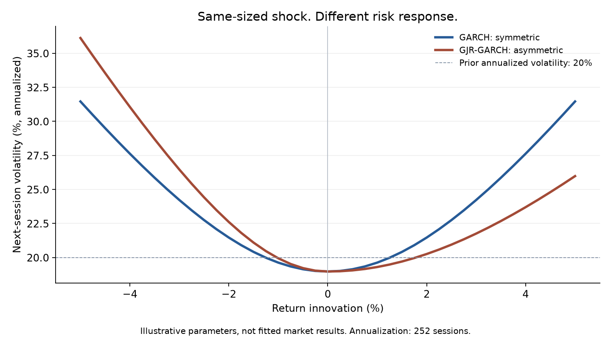

# GARCH Volatility Modeling

**Inspect how a return shock changes the next risk estimate.**

This research prototype explores GARCH(1,1), GJR-GARCH, EGARCH and HAR-RV, with explicit Gaussian likelihood code in the preserved source archive. The bounded public exhibit below isolates a mechanism that can be verified directly. It does not establish investment performance or forecast superiority.

[Interactive portfolio exhibit](https://joshgutierrez56.github.io/#project-garch-volatility) · [Equations and parameters](docs/NEWS_IMPACT.md) · [Exact exhibit data](docs/exhibit/news-impact.json)

## What the exhibit shows

Both models start from 20% annualized volatility. GARCH responds identically to equal positive and negative shocks. With a positive negative-shock coefficient, GJR responds more strongly to a loss. The parameters are specified, not estimated. A plausible mechanism is not proof of better forecasting.

Install Matplotlib, then run `python scripts/build_news_impact_exhibit.py` to rebuild the 41-scenario chart and run four independent arithmetic checks. [Methodology](docs/NEWS_IMPACT.md) distinguishes conditional volatility from losses, VaR, and returns.

## Source and validation boundary

The original [garch_volatility.zip](garch_volatility.zip) is preserved. It contains the model implementations, tests, chart functions, and legacy pipeline. The root CLI requires the archive's source package; the archive is not a self-contained installed package merely because the root runner exists.

The **legacy full-pipeline forecast rankings are not validated results**. Audit findings include a one-day realized-variance target calculated from a one-observation variance (zero), missing EGARCH forecasting, a next-step forecast that omits the latest realized shock, and in-sample rather than held-out VaR evaluation. The former placeholder ranking has been withdrawn from this README. Do not use those legacy outputs to select a model. The bounded news-impact exhibit does not depend on those paths.

A full research release must correct forecast timing and targets, handle optimizer failures explicitly, compare models on common observations, reconcile VaR coverage, and record data provenance before making empirical claims.

## References

Bollerslev (1986), GARCH; Glosten, Jagannathan and Runkle (1993), asymmetric conditional volatility; Nelson (1991), EGARCH; Corsi (2009), HAR-RV; Patton (2011), volatility forecast comparison; Kupiec (1995), unconditional VaR coverage.
